<!--
    Ehasan07 / Ehasan07 — GitHub profile README
    Renders at https://github.com/Ehasan07
-->

  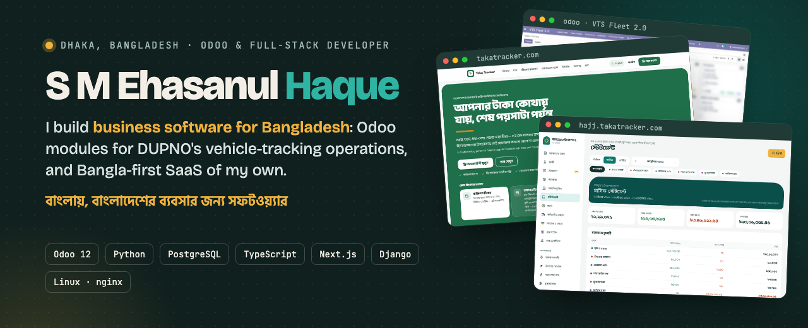

  
  
  

## Hi, I'm Ehasan

I'm an **Odoo and full-stack developer at DUPNO International** in Dhaka. At work I build Odoo 12 modules for the company's vehicle-tracking (VTS) operations — the fleet register, SIM recharge, voice campaigns, tracking certificates, equipment handover and the call-centre desk. Outside them I build Bangla-first SaaS: a Hajj agency platform, a personal finance app, a trading ERP and a digital business card.

A few rules I hold to in every project:

- **Bangla first**, English one tap away.
- **Money is counted in paisa**, never in floating point — totals match to the last taka.
- **Never break the system next door**: an add-on must not slow down or block the module it sits on.
- **It ships**: tested, deployed on a real server, with backups.

 

## Odoo modules at DUPNO

Company work, so the source is private. Screens are from the modules themselves; customer data is blurred.

<table>
  <tr>
    <td width="50%" valign="top">
      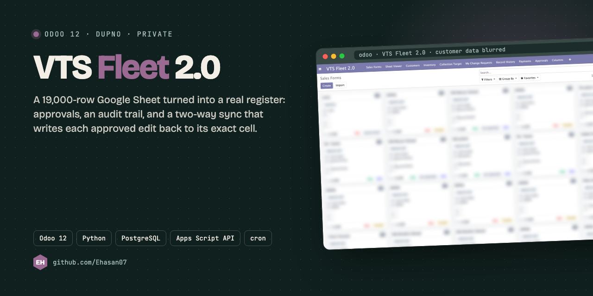
       <b>VTS Fleet 2.0</b> — a 19,000-row Google Sheet behind a real register: every edit goes through approval, keeps an audit trail and is written back to its exact cell.
       Python · Odoo ORM · Google Apps Script write-back API · cron retries
    </td>
    <td width="50%" valign="top">
      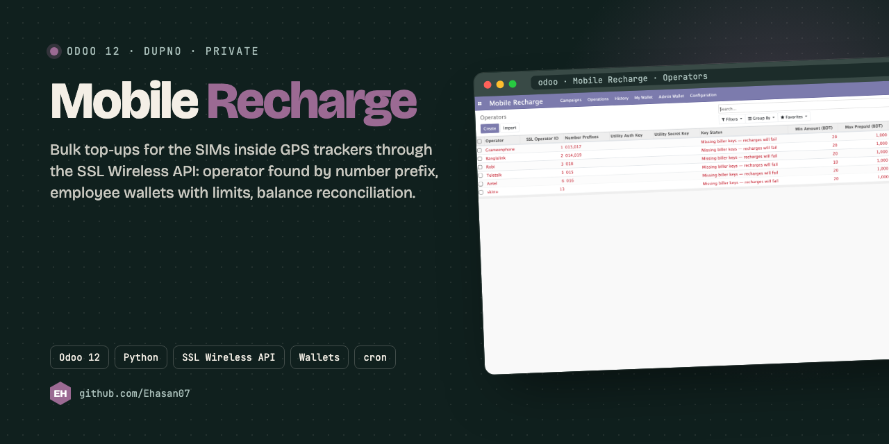
       <b>Mobile Recharge</b> — bulk top-ups for the SIMs inside GPS trackers: the operator is read from the number prefix, employees spend from wallets with limits, and the ledger is checked against the live balance.
       SSL Wireless TopUp API · wallets · computed fields with search
    </td>
  </tr>
  <tr>
    <td width="50%" valign="top">
      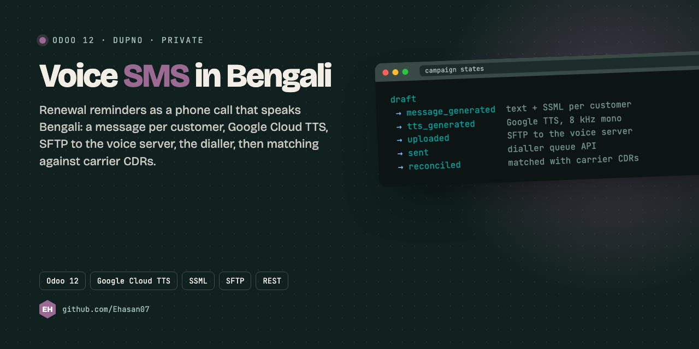
       <b>Voice SMS in Bengali</b> — a renewal reminder as a phone call: one rendered audio file per customer, uploaded to the voice server, dialled, then matched against the carrier's call records.
       Google Cloud TTS · SSML · SFTP (paramiko) · queue API · CDR reconciliation
    </td>
    <td width="50%" valign="top">
      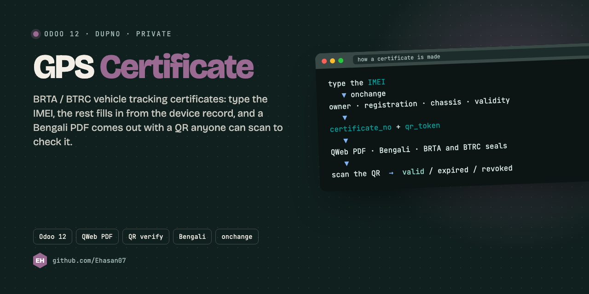
       <b>GPS Certificate</b> — the BRTA / BTRC vehicle tracking certificate: type the IMEI and the rest fills itself; a Bengali PDF with a QR code that checks the live status.
       QWeb PDF · Bengali typeface · QR verification endpoint · onchange
    </td>
  </tr>
  <tr>
    <td width="50%" valign="top">
      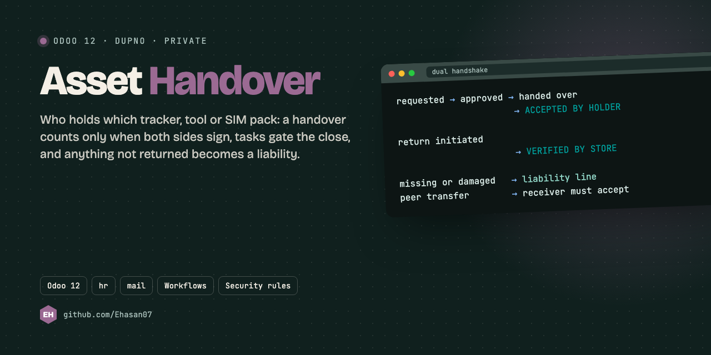
       <b>Asset Handover</b> — who holds which tracker, tool or SIM pack: a handover counts only when both sides sign, open tasks block the close, and what isn't returned becomes a liability.
       hr · mail · state workflows · record rules
    </td>
    <td width="50%" valign="top">
      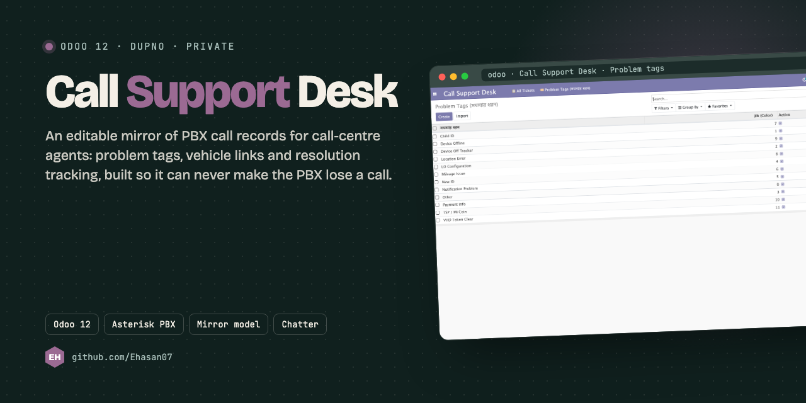
       <b>Call Support Desk</b> — an editable mirror of the PBX call records for call-centre agents, with problem tags and vehicle links, written so it can never make the PBX lose a call.
       Asterisk PBX · inherited create · non-blocking mirror · chatter
    </td>
  </tr>
</table>

<b>What I do in Odoo</b>

 

| Area | In these modules |
|---|---|
| Models and ORM | New models, inheritance of existing ones, computed fields with `search`, onchange, constraints |
| Views | Kanban, list, form and search views in XML; menus and actions per role |
| Reports | QWeb PDF in Bengali with seals and QR codes |
| Security | Groups, access rights, record rules, approval workflows with audit trails |
| Automation | Scheduled actions (cron) for sync, retries, balance checks and reconciliation |
| Integrations | Google Sheets / Apps Script, SSL Wireless, Google Cloud TTS, SFTP, Asterisk PBX, REST endpoints |

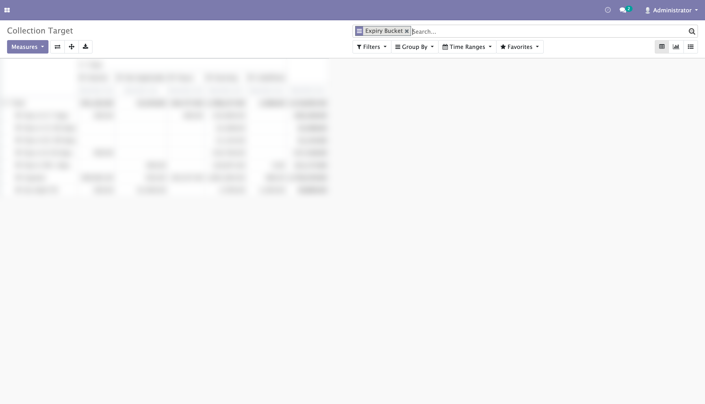

 

## Products I built

<table>
  <tr>
    <td width="50%" valign="top">
      
       <b>Hajj Tracking</b> — SaaS for Hajj &amp; Umrah agencies: pilgrims, QR-verified receipts, statements, payroll, hotels and four side shops.
       <a href="https://hajj.takatracker.com">Live</a> · <a href="https://github.com/Ehasan07/hajj-tracking-software">Code</a> · Next.js · tRPC · PostgreSQL
    </td>
    <td width="50%" valign="top">
      <a href="https://github.com/Ehasan07/takatracker">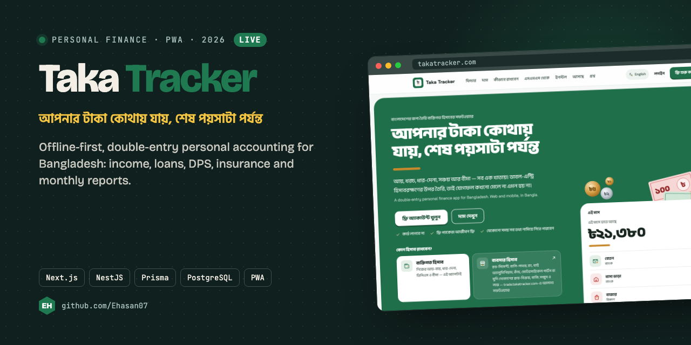</a>
       <b>Taka Tracker</b> — offline-first, double-entry personal accounting for Bangladesh, in Bangla and English.
       <a href="https://takatracker.com">Live</a> · <a href="https://github.com/Ehasan07/takatracker">Code</a> · Next.js · NestJS · Prisma
    </td>
  </tr>
  <tr>
    <td width="50%" valign="top">
      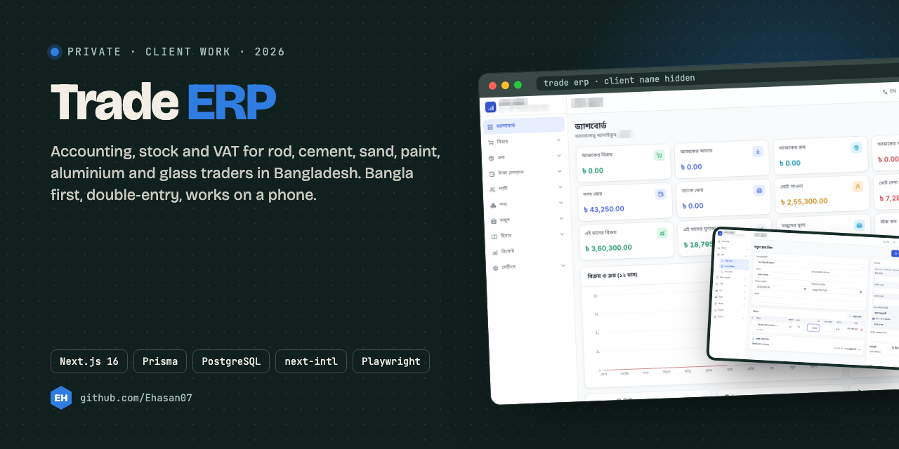
       <b>Trade ERP</b> — accounting, stock and VAT for rod, cement, sand, paint, aluminium and glass traders. Bangla first, double-entry, works on a phone.
       Next.js · Prisma · PostgreSQL · private client work, client name hidden
    </td>
    <td width="50%" valign="top">
      <a href="https://mycard.dupno.com">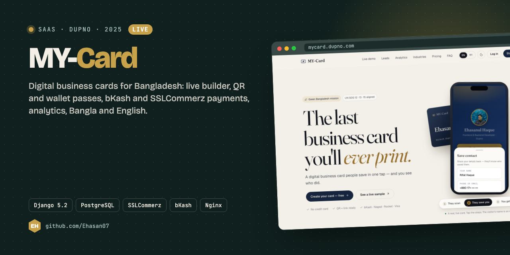</a>
       <b>MY-Card</b> — digital business cards: live builder, QR and wallet passes, bKash and SSLCommerz payments, analytics.
       <a href="https://mycard.dupno.com">Live</a> · Django · PostgreSQL · source private
    </td>
  </tr>
</table>

<b>More from Trade ERP</b>

 

  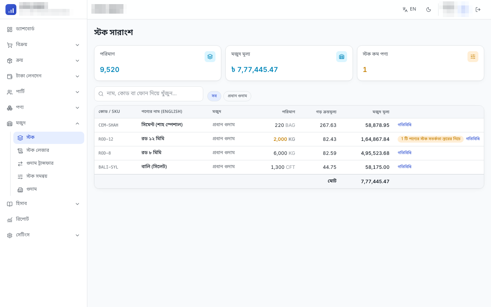
  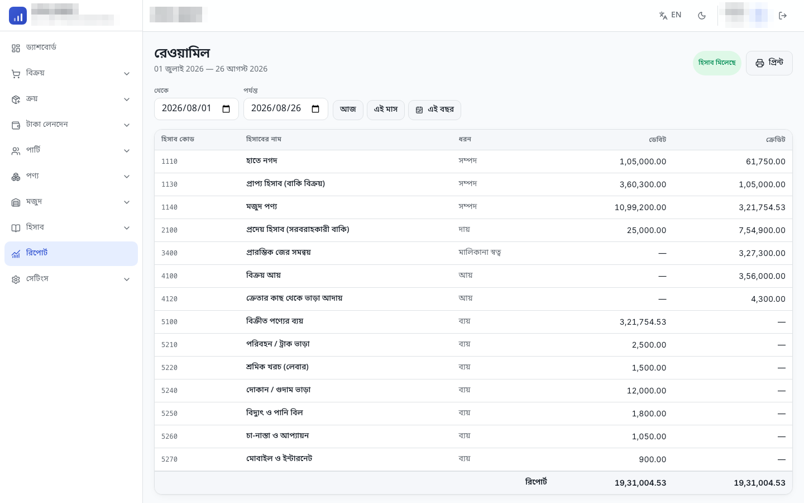

 

## Client web work for DUPNO

<table>
  <tr>
    <td width="33%" valign="top">
      <a href="https://github.com/Ehasan07/dupno-payment">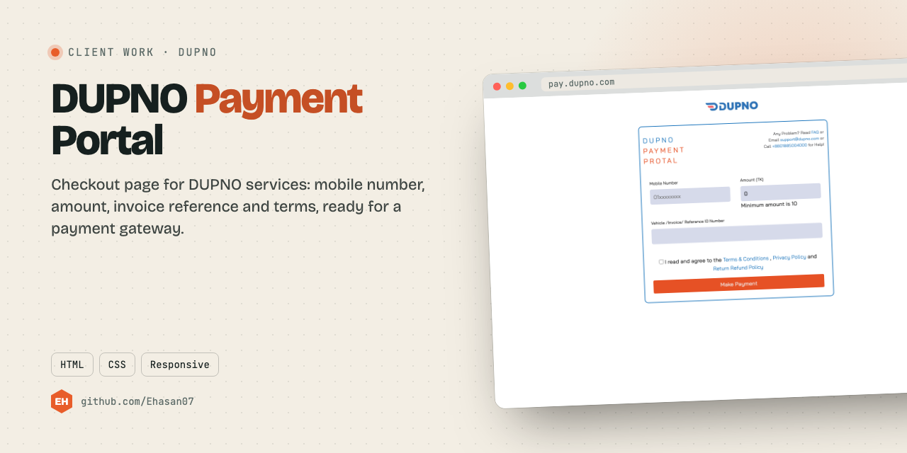</a>
       <b>Payment Portal</b> Checkout page for DUPNO services
    </td>
    <td width="33%" valign="top">
      <a href="https://github.com/Ehasan07/Dupno-fuel-monitor">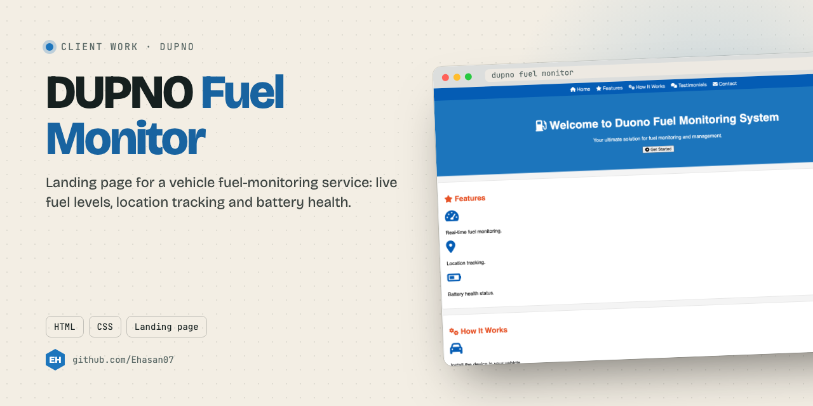</a>
       <b>Fuel Monitor</b> Landing page for vehicle fuel monitoring
    </td>
    <td width="33%" valign="top">
      
       <b>Service Comparison</b> Bangla package table, filtered by vehicle
    </td>
  </tr>
</table>

 

## Web apps, games and experiments

<table>
  <tr>
    <td width="33%" valign="top">
      
       <b>ehasanlive.com</b> Bilingual portfolio · React, Tailwind, Framer Motion
    </td>
    <td width="33%" valign="top">
      <a href="https://github.com/Ehasan07/V-card">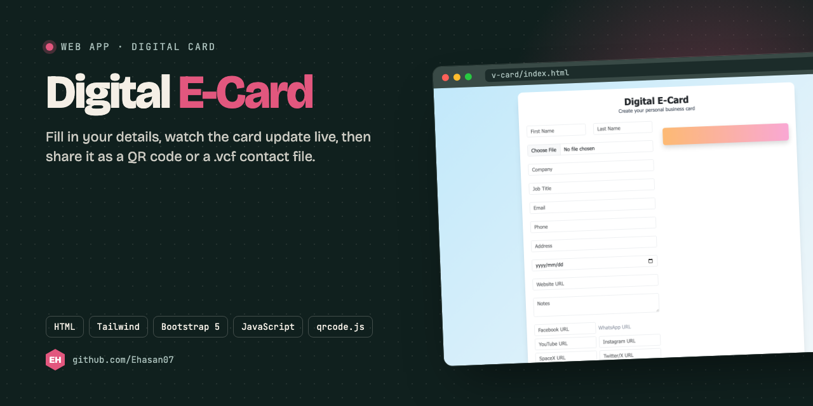</a>
       <b>Digital E-Card</b> Live card builder with QR and .vcf
    </td>
    <td width="33%" valign="top">
      <a href="https://github.com/Ehasan07/React-World-Tour">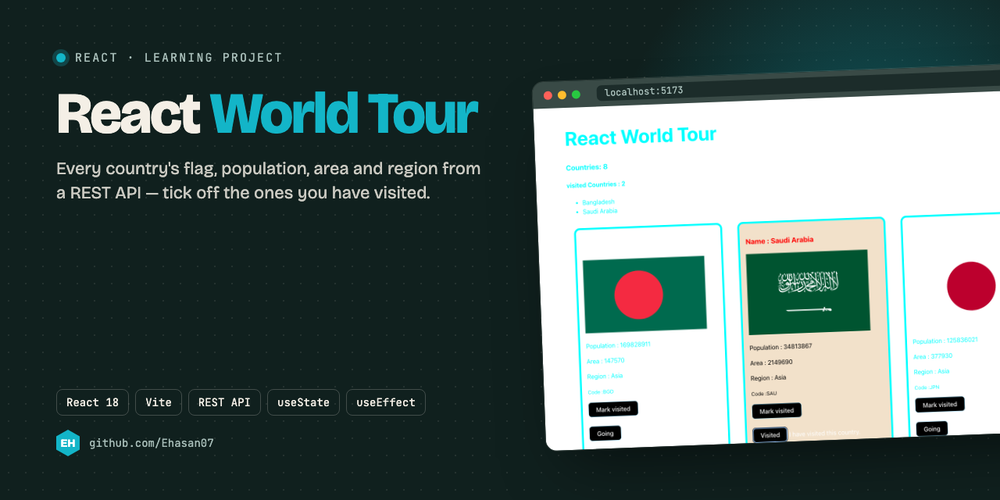</a>
       <b>React World Tour</b> Every country from a REST API
    </td>
  </tr>
  <tr>
    <td width="33%" valign="top">
      <a href="https://github.com/Ehasan07/Alphabate-game">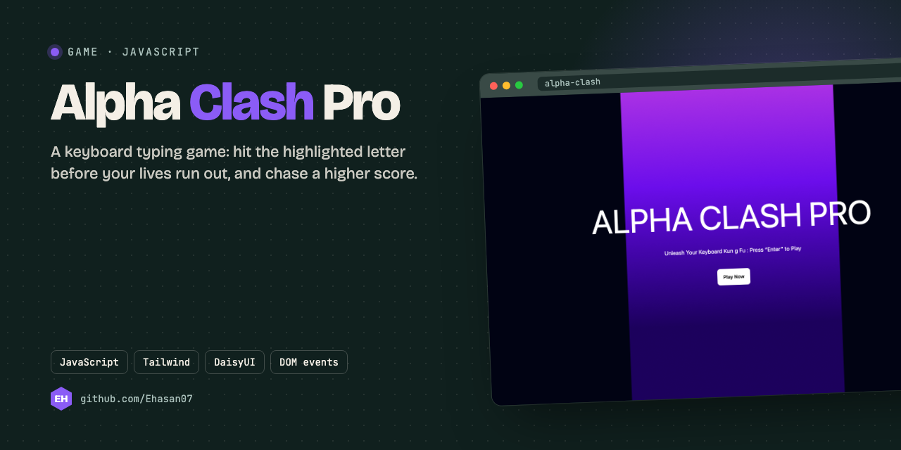</a>
       <b>Alpha Clash Pro</b> Keyboard typing game
    </td>
    <td width="33%" valign="top">
      <a href="https://github.com/Ehasan07/tic-tac-toe-game">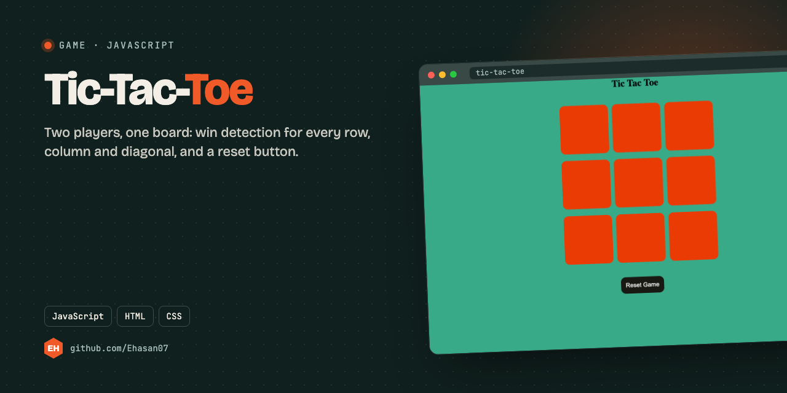</a>
       <b>Tic-Tac-Toe</b> Two players, vanilla JavaScript
    </td>
    <td width="33%" valign="top">
      
       <b>Book Manager</b> Python command-line app
    </td>
  </tr>
  <tr>
    <td width="33%" valign="top">
      <a href="https://github.com/Ehasan07/Mouse-hover">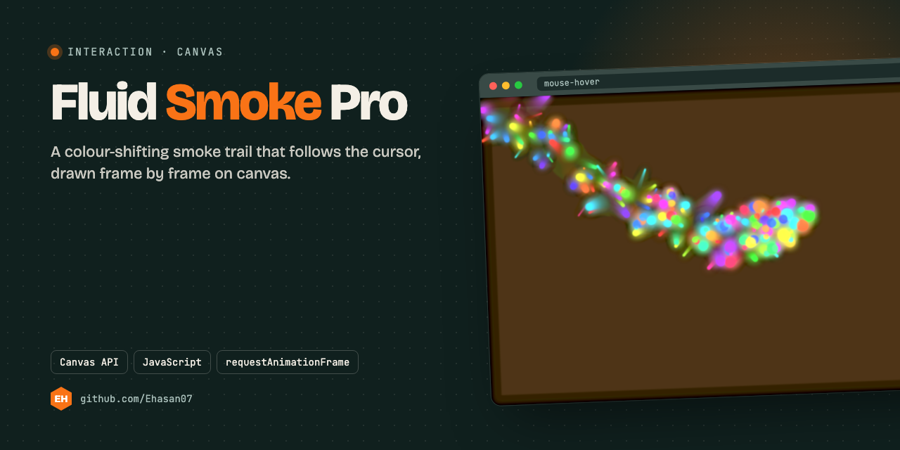</a>
       <b>Fluid Smoke Pro</b> Canvas animation
    </td>
    <td width="33%" valign="top">
      <a href="https://github.com/Ehasan07/hexagonal-grid-interaction">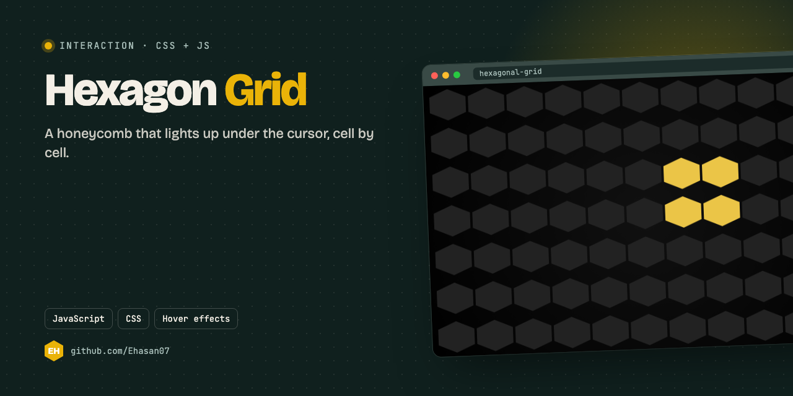</a>
       <b>Hexagon Grid</b> Honeycomb hover effect
    </td>
    <td width="33%" valign="top">
      <a href="https://github.com/Ehasan07/fluid-hover">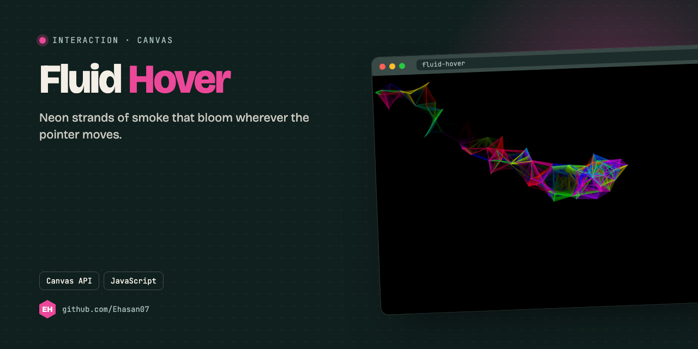</a>
       <b>Fluid Hover</b> · <a href="https://github.com/Ehasan07/interesting-cursor-hover">Cursor Trails</a> More canvas experiments
    </td>
  </tr>
</table>

 

## How I got here

| When | What I was building |
|---|---|
| **Jan 2024** | [First repository](https://github.com/Ehasan07/my-frist-github-repo), [first portfolio](https://github.com/Ehasan07/web-developer-portfolio), and assignment 1: a [Figma design in HTML](https://github.com/Ehasan07/My-frist-assignment) |
| **Jan – May 2024** | Assignments 2–6: [AMA Travel](https://github.com/Ehasan07/2nd-assignment-), [Hockey Club](https://github.com/Ehasan07/3rd-assignment), [JS problem solving](https://github.com/Ehasan07/4th-assignment), [P-Paribahan tickets](https://github.com/Ehasan07/5th-assignment), [Retro Forum](https://github.com/Ehasan07/6th-assignment) |
| **2024** | First games and React: [Alpha Clash Pro](https://github.com/Ehasan07/Alphabate-game), [Tic-Tac-Toe](https://github.com/Ehasan07/tic-tac-toe-game), [React World Tour](https://github.com/Ehasan07/React-World-Tour) · first client pages for DUPNO |
| **At DUPNO** | Odoo 12 modules for the VTS operations: fleet register, SIM recharge, Bengali voice campaigns, tracking certificates, asset handover, call-centre desk |
| **2025** | Python, canvas experiments, the [Digital E-Card](https://github.com/Ehasan07/V-card), then **MY-Card**, a Django SaaS with payments |
| **2026** | [ehasanlive.com](https://ehasanlive.com) rebuilt, **Taka Tracker**, **Trade ERP** and **Hajj Tracking** — full SaaS products in TypeScript, live on my own servers |

 

## Tools I use

  
  
  
  
  
  

  
  
  
  
  
  
  
  
  

  
  
  
  
  
  
  
  

 

## Get in touch

  
  
  

Ship it. Read it six months later. If it still makes sense, it's done.

